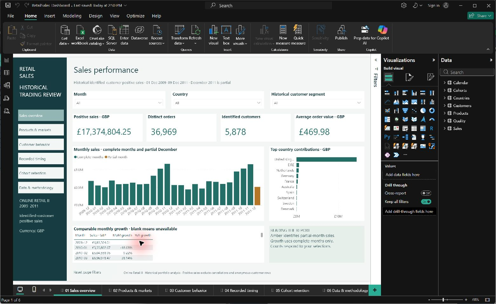

# Retail sales analytics

A notebook-first analysis of historical UK retail invoice lines, using Python,
SQL and Power BI. It examines sales concentration, products, observed customer
behavior and trading patterns to help a retail manager choose follow-up investigations.

[Problem statement](PROBLEM_STATEMENT.md) · [Editable Power BI report](power_bi/RetailSales.pbip) · [Source manifest](data/raw/manifest.json)



## Measured results

| Measure | Result |
|---|---:|
| Source invoice lines | 1,067,371 |
| Eligible positive-sales lines | 779,425 |
| Positive sales, GBP | 17,374,804.25 |
| Distinct orders | 36,969 |
| Identified customers | 5,878 |
| Stock codes / countries | 4,631 / 41 |
| Average order value, GBP | 469.98 |
| Repeat customers / rate | 4,255 / 72.39% |

The United Kingdom contributes **82.82%** of eligible sales. Stock code **22423**
(REGENCY CAKESTAND 3 TIER) leads by sales. Approximately 20% of observed customers
account for **77.25%** of sales. These patterns justify investigation; no business
intervention, achieved savings or campaign uplift is measured.

Coverage is **1 December 2009–9 December 2011**. The final month is incomplete.
Cancellations, missing-customer records and repeated source rows are excluded.
Positive identified-customer sales are not net revenue or profit.

## Structure

| Location | Purpose |
|---|---|
| `data/` | Local source, checked fact and quality records; public source manifest |
| `notebooks/01_source_profile.ipynb` | Verify provenance, inspect grain and profile quality |
| `notebooks/02_clean_transform.ipynb` | Actual cleaning, transformation, boundary checks and analytical tables |
| `notebooks/03_analysis_validation.ipynb` | Independent raw/SQL controls, findings, charts and business brief |
| `sql/` | Ordered schema/analysis SQL and a standalone MySQL/SQL comparison helper |
| `power_bi/` | Native dashboard, report/model source, generated tables, charts and brief |

There is no separate Python package or tests folder. Working analysis is visible
in the notebooks; assertions and independent SQL checks run within that workflow.
The report's `.Report` and `.SemanticModel` folders are native Power BI source,
so keep them beside the PBIP.

Raw data, customer-level exports, generated outputs, imported report binaries,
caches, credentials and personal reading guides are ignored by Git. Only the
root README and problem statement are public Markdown. Local section guides and
FULL_RUNBOOK.md explain the complete learning and rerun workflow.

## Reproduce the analysis

Use Python 3.11 or later, Jupyter and Power BI Desktop with PBIP/PBIR support.
MySQL 8 is optional; SQLite checks run inside notebook 03 without a server or a
saved database file. No web application or cloud account is required.

1. Obtain [Online Retail II from UCI](https://doi.org/10.24432/C5CG6D). Place
   `online_retail_II.csv` in `data/raw/`. The manifest identifies the original
   local CSV used here; its conversion from UCI's workbook was not independently
   reproduced. For the original two-sheet XLSX, set SOURCE consistently in
   notebooks 01 and 02; the loader combines all sheets.
2. From the project root, prepare Python and launch Jupyter:

   ```powershell
   python -m venv .venv
   .venv\Scripts\python.exe -m pip install -r requirements.txt
   .venv\Scripts\python.exe -m jupyterlab
   ```

3. Restart the kernel and Run All for **01 → 02 → 03**, in order. Inspect the
   boundary checks, exclusion counts and validation results before continuing.
   Code and its explanation are together in each notebook. Generated outputs
   replace the previous run; the source remains unchanged.
4. Read `power_bi/ANALYSIS.md` and `data/quality/validation_results.json`.
   Analytical tables are in `power_bi/tables/`; nine static charts are in
   `power_bi/figures/`. Do not force the baseline if the source changes.
5. Open [RetailSales.pbip](power_bi/RetailSales.pbip). Set **ProjectFolder** in
   Transform data → Edit parameters to this repository's absolute path, without
   a final slash. The shared default is empty. Apply and Refresh after the
   notebooks pass, then compare unfiltered cards with `data/quality/kpis.json`.

For optional native MySQL loading and full-content/analytical checks:

```powershell
.venv\Scripts\python.exe sql/run_sql.py --user YOUR_MYSQL_USER
```

The helper prompts privately for a password and uses `sales_analytics`. Identical
existing data is reused. Differing data is rejected unless `--replace-sales` is
explicitly supplied; that option retains the previous table as a backup.
Power BI imports local files and needs no database credential.

## Dashboard

The six pages cover **sales overview, products and markets, customer behavior,
recorded timing, cohort retention, and data/methodology**. The local
`power_bi/RetailSales_Dashboard.pbix` contains imported data and is excluded from
Git; a fresh checkout must regenerate inputs and refresh the editable PBIP.

Trading-page slicers are page-local. In Desktop edit mode, activate navigation
and reset with Ctrl+click or select a button and press Ctrl+Enter. Reset clears
that page's slicers; click blank canvas to clear a chart selection. Cohort
retention is a separate full-history snapshot with its own filter.

Eight tables and four active single-direction relationships support 32
analytical/context measures and 30 hidden presentation measures. Authoritative
Power Query and DAX are in `RetailSales.SemanticModel/model.bim`. Dedicated phone
layouts are included; wide charts and matrices may scroll.

## Definitions and verification

- Sales = sum of per-line integer pence / 100; unit prices retain up to 3 decimals
  before half-up line rounding. AOV = selected sales / distinct selected invoices.
- Customers and products are distinct normalized CustomerID and StockCode. Counts
  across countries/products are non-additive. Product-filtered AOV means selected
  product sales per containing invoice.
- Cleaning applies one rejection reason per source row. Repeated trimmed source
  fields are removed with first occurrence retained; repeat lines may be genuine
  because no unique source line identifier exists.
- RFM uses tie-preserving quintiles at the historical cutoff. Cohorts use first
  observed purchase; future cells are blank and observed inactivity is zero.
- Comparable MoM/YoY require complete selected months and an available nonzero
  complete comparison period. December 2011 is partial.

The three notebooks executed in fresh kernels after simplification. All 33
source/invariant/SQLite check groups passed. The [comparison results](power_bi/validation.csv)
also record 14 native metric comparisons across baseline, Australia and partial-month contexts.

The notebook workflow independently reconciles raw-source money using Decimal
and executes all nine SQL queries. It checks fact keys, customer grain, calendar
continuity and cohort bounds. Native Power BI checks previously covered baseline,
grouped/combined filters, partial periods, empty selections, slicer reset, six
pages and the overview phone preview. A Python rerun does not perform a native
Power BI refresh. Physical-device testing, online publication and scheduled
refresh have not been performed.

## Source and limits

Daqing Chen (2012), [Online Retail II, UCI](https://doi.org/10.24432/C5CG6D).
The [catalog](https://archive.ics.uci.edu/dataset/502/online+retail+ii) specifies
sterling prices and CC BY 4.0 dataset licensing. Software is MIT.

The source lacks costs, profit, inventory availability, marketing exposure and a
specified timestamp timezone. First observed purchase does not prove acquisition.
RFM labels do not establish churn. Recorded patterns do not prove causation.
